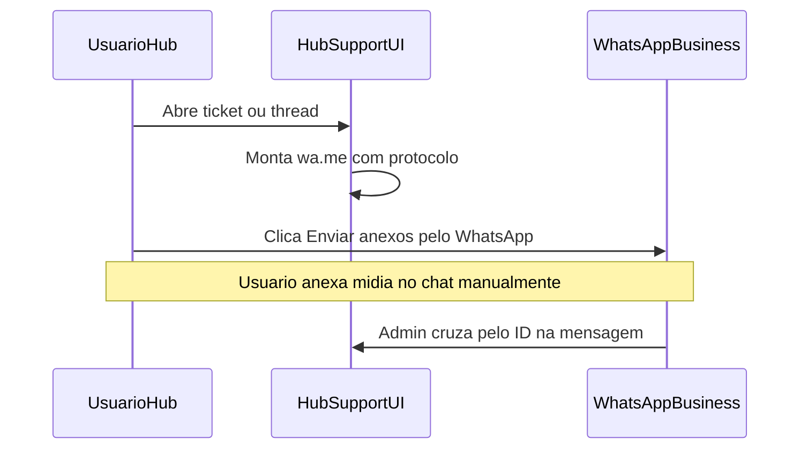

# Anexos de suporte via WhatsApp (Hub)

## Decisão

- Escopo: **somente Hub** (Shift fica de fora).
- Sem Storage / sem upload de arquivo.
- Reutilizar o número já previsto em [`VITE_HUB_SUPPORT_WHATSAPP_PHONE`](apps/hub-web/.env.example) (WhatsApp Business). Se o env estiver vazio, o CTA **não aparece** (mesmo padrão do item “Feedback beta” no menu).

## Fluxo



## Mensagem pré-preenchida

Texto fixo em pt-BR, com protocolo rastreável (8 primeiros caracteres do UUID, alinhado à UI):

```text
Anexo do ticket #a1b2c3d4 (PetMi Hub)
Assunto: Técnico
Abri o chat para enviar print/PDF referente a este ticket.
```

Incluir o ID curto com `#` para busca no WhatsApp/admin. Manter a UI de lista/thread em `#{id.slice(0, 8)}` (hoje usa 6 em [`HubSupportTicketsPage.tsx`](packages/hub-ui/src/pages/suporte/HubSupportTicketsPage.tsx)).

## Implementação

### 1. Helper de link (hub-ui + hub-web)

- Em [`packages/hub-ui/src/utils/whatsappLink.ts`](packages/hub-ui/src/utils/whatsappLink.ts) (ou arquivo irmão em `pages/suporte/`): função pura `buildSupportTicketAttachmentMessage({ ticketId, categoryLabel })` + uso de `buildWhatsappLink(phone, message)`.
- Em [`apps/hub-web/src/constants/hubSupportWhatsapp.ts`](apps/hub-web/src/constants/hubSupportWhatsapp.ts): exportar helper que usa `HUB_SUPPORT_WHATSAPP_PHONE` + o builder acima (ex.: `getHubSupportTicketAttachmentHref(ticketId, categoryLabel)`).
- Em [`apps/hub-web/src/App.tsx`](apps/hub-web/src/App.tsx): passar o telefone (ou um getter de href) para a página — `HubSupportTicketsPage` vive em `@petimi/hub-ui` e **não** deve ler `import.meta.env` do app.

### 2. CTA na thread do ticket

Em [`HubSupportTicketsPage.tsx`](packages/hub-ui/src/pages/suporte/HubSupportTicketsPage.tsx) + [`hub-support.css`](packages/hub-ui/src/pages/suporte/hub-support.css):

- Nos tickets **abertos** (não closed/evaluating): link/botão “Enviar anexos pelo WhatsApp” perto do hint/composer.
- Texto de ajuda curto: o WhatsApp abre com o protocolo; a pessoa ainda precisa anexar a mídia no chat.
- `target="_blank"` + `rel="noopener noreferrer"`.
- Se não houver número configurado → ocultar o CTA.

### 3. Pós-criação

Em `handleCreated` / toast atual: reforçar que, se precisar de print/PDF, use o botão de anexos no ticket (já navega para `?ticket=...`). Sem modal extra.

### 4. Configuração

- Documentar/preencher `VITE_HUB_SUPPORT_WHATSAPP_PHONE` no `.env` local e nos envs de deploy do `hub-web` com o número Business (somente dígitos + DDI 55). Nenhuma migration/backend.

## Fora de escopo

- Shift / `SupportModal` com upload stub
- Upload para Supabase Storage
- Anexos por mensagem no banco
- API oficial do WhatsApp (só `wa.me` click-to-chat)