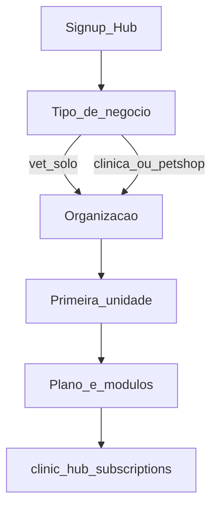

# Plano pós-MVP: Vet Solo no Hub

## Contexto (estado atual)

- Catálogo já tem: `beta`, `solo` (**Essencial**, 1 unidade / 5 users), `growth` (**Expansão**), `network` (**Rede**) — ver seed em [`082_create_hub_platform_subscriptions.sql`](backend/database_migrations/petimi_hub/082_create_hub_platform_subscriptions.sql).
- Modelo: **plano base = capacidade**; **módulos = o que opera** (`hub_core`, `clinic`, `grooming`, `boarding`).
- Onboarding atual ([`HubClinicOnboardingPage.tsx`](apps/hub-web/src/pages/HubClinicOnboardingPage.tsx)): **Organização → Primeira unidade → Plano**. API exige `clinic` + `unit` ([`hubSignupController.ts`](backend/src/modules/hub/hubSignupController.ts)); sessão Hub depende de `unit_id`.
- Enforcement de módulos/limites ainda é Fase 2 (`HUB_SUBSCRIPTION_MODE=catalog`) — ver [`.cursor/plans/planos_hub_beta.plan.md`](.cursor/plans/planos_hub_beta.plan.md).

**Não renomear nem remover planos existentes.** Solo “Essencial” (`slug: solo`) continua; o novo produto é **mais um** SKU.

## Decisões de produto (fechadas neste plano)

| Item | Decisão |
|------|---------|
| Slug DB | `vet_solo` |
| Nome de vitrine | **Solo** |
| Subtítulo / description | Ex.: “Veterinário independente ou volante — agenda, clientes e clínica.” |
| Capacidade | `max_units = 1`, `max_users = 2` (vet + 1 auxiliar) |
| Módulos | Fixos: `hub_core` + `clinic`. Sem `grooming` / `boarding`. Upgrade de módulos exige outro plano base. |
| Unidade no onboarding | **Continua obrigatória** (não remover do modelo). |
| Tipo de cliente | Card de **tipo de negócio** no onboarding (preset UI) — ver abaixo. |
| Quando implementar | Pós-MVP / modo `catalog`. Agora: seed inativo + doc de mapeamento. |

## Por que não tirar a primeira unidade

Remover unidade “só no Solo” muda o núcleo do Hub (agenda, encounters, caixa, RLS, seletor de unidade, `getHubSessionContext`). Custo alto e frágil.

**Abordagem:** unidade continua existindo; no fluxo Solo a UX trata como **área de atendimento** (ex.: nome padrão “Atendimento móvel / domiciliar”), com endereço pré-preenchido da organização e `is_main=true`. Backend segue criando `units` como hoje.

## Tipo de negócio (card) vs plano

São duas coisas:

1. **Tipo de negócio** (preset de UX no onboarding) — atalho que pré-escolhe plano + módulos.
2. **Plano SaaS** — registro em `hub_platform_plans` / assinatura.

Presets sugeridos (não são rows de plano; só UI + payload):

| Card | Pré-seleção |
|------|-------------|
| **Solo** (vet / volante) | `base_plan=vet_solo`, módulos `hub_core`+`clinic` (travados) |
| **Clínica veterinária** | `solo` ou `growth` + módulo `clinic` (usuário ainda pode ajustar) |
| **Pet shop** | `solo` + `grooming` |
| **Completo** | plano adequado + todos os módulos públicos |

Ordem do wizard pós-MVP: **Tipo de negócio → Organização → Primeira unidade → Plano** (no Solo, o step Plano confirma o pacote travado; nos outros, permite ajuste).

CNPJ da organização permanece no MVP deste SKU (evita refactor fiscal). Copy pode falar em CNPJ/MEI; aceitar CPF como documento da org fica **fora** deste escopo (follow-up).

## O que fica desativado / limitado em `vet_solo`

### Hard (assinatura + enforcement)

| Recurso | Comportamento |
|---------|----------------|
| Módulo `grooming` | Não entra em `enabled_modules`; rotas/menus Banho & Tosa bloqueados |
| Módulo `boarding` | Idem Hotel & Creche |
| 2ª+ unidade | Bloqueado (`max_units=1`) |
| 3º+ usuário / convite | Bloqueado (`max_users=2`) |
| Trocar módulos no self-service | Negado enquanto `base_plan_slug=vet_solo` (só upgrade de plano) |

Alinhar com regra já documentada: `hasPermission AND organizationHasModule`.

### Soft (áreas operacionais / UI — não são módulos do catálogo hoje)

Hoje Leva e Traz, Recepção, Estoque etc. não têm slug em `hub_platform_modules`. Para Solo, mapear **áreas desabilitadas** no plano (campo novo ou JSON de config do plano), espelhando [`operationalAreas.ts`](packages/web-core/src/operationalAreas.ts) e itens de [`HubSidebar.tsx`](apps/hub-web/src/components/HubSidebar.tsx):

| Área / menu | Solo |
|-------------|------|
| Banho & Tosa | Off (módulo) |
| Hotel & Creche | Off (módulo) |
| Leva e Traz (frota/rotas) | Off — volante agenda visita na **Agenda**, sem módulo de frota |
| Recepção (fila) | Off ou escondida — check-in pode viver na Agenda/Clínica |
| Clínica | On |
| Agenda, Clientes, Pets, Orçamento | On (`hub_core`) |
| Caixa / Financeiro | On (cobrança simples do atendimento) |
| Serviços (catálogo) | On |
| Estoque | On (insumos/medicamentos; opcional reavaliar depois) |
| Equipe | On, limitado a 2 acessos |
| Relatórios | On, só dados dos módulos ativos |
| Multi-unidade / seletor complexo | Esconder ou simplificar (sempre 1 unidade) |

**Fora do Hub Solo:** fluxo de plantões/demandas (Vet-Match) continua no app Vet — não entra neste SKU.

## Schema / backend (quando for implementar)

1. Nova migration (não alterar o seed histórico do `082` em produção já aplicada; INSERT novo):
   - `hub_platform_plans`: slug `vet_solo`, name `Solo`, `max_units=1`, `max_users=2`, `is_public=true` só com `HUB_SUBSCRIPTION_MODE=catalog`, `active=true` quando lançar.
   - Opcional recomendado: coluna `plan_config jsonb` (ou tabela satélite) com `allowed_modules`, `locked_modules`, `disabled_operational_areas` para não hardcodar só no front.
2. [`hubSubscriptionService.ts`](backend/src/modules/hub/hubSubscriptionService.ts):
   - Constantes do plano; ao criar/atualizar assinatura `vet_solo`, forçar `enabled_modules = ['hub_core','clinic']`.
   - `organizationHasModule` + futuros `requireOrgModule` / limites de unit/user.
3. Onboarding `POST /api/hub/onboarding/clinic`: aceitar `business_type` / `plan_slug` no modo catalog; se `vet_solo`, ignorar módulos enviados pelo client e aplicar o pacote travado.
4. Session: expor `base_plan_slug`, `enabled_modules` e (se houver) `disabled_operational_areas` para sidebar/gating.
5. Admin plataforma: poder ver/trocar plano (incluindo upgrade Solo → Essencial/Expansão).

## Frontend (quando for implementar)

- Card **tipo de negócio** no onboarding + copy da unidade adaptada quando tipo = Solo.
- Step Plano: pacote Solo read-only (sem checkboxes de B&T/Hotel).
- [`HubSidebar.tsx`](apps/hub-web/src/components/HubSidebar.tsx) + hook de módulos/áreas: filtrar por módulo **e** áreas desabilitadas do plano.
- Página Plano / assinatura: texto claro do que está incluso e CTA de upgrade.
- Atualizar docs: [`HUB_PLATFORM_SUBSCRIPTION_PLAN.md`](docs/architecture/HUB_PLATFORM_SUBSCRIPTION_PLAN.md) e [`.cursor/plans/planos_hub_beta.plan.md`](.cursor/plans/planos_hub_beta.plan.md) (catálogo pós-MVP).

## Entrega agora (só mapeamento)

Sem ativar catálogo nem enforcement em produção:

1. Registrar este plano como referência pós-MVP (este arquivo / doc de arquitetura).
2. Quando o time for à Fase 2 do catálogo, incluir seed `vet_solo` **junto** com ativação de `solo`/`growth`/`network`, não no lugar deles.
3. Critérios de aceite pós-MVP (resumo):
   - Conta Solo só vê Agenda/Clientes/Pets/Clínica/Financeiro/Serviços/(Estoque)/Equipe≤2.
   - Tentativa de abrir Banho & Tosa, Hotel ou 2ª unidade → bloqueio backend + UI.
   - Onboarding Solo ainda cria exatamente 1 `unit`.
   - Contas Essencial/Expansão/Rede/Beta inalteradas.

## Fora de escopo (follow-ups explícitos)

- Aceitar CPF no lugar de CNPJ na organização.
- App / domínio separado para Solo.
- Módulo formal `pickup` no catálogo SaaS.
- Integração Solo ↔ demandas Vet-Match no mesmo onboarding.