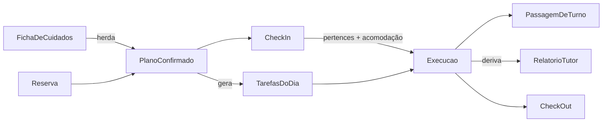

# PetMi Hub — Hotel & Creche: módulo operacional

Contrato de produto e de implementação da operação de **Hotel & Creche** (`/hub/hotel-creche`). Substitui a versão de jun/2026, que organizava o módulo em torno de reservas e de um relatório diário com três caixas de seleção.

Documentos relacionados: [modelo de domínio](./HUB_DOMAIN_MODEL.md), [modelo financeiro](./HUB_FINANCIAL_MODEL.md), [plano de comunicação WhatsApp](./HUB_COMMUNICATION_WHATSAPP_PLAN.md), [Banho & Tosa](./HUB_GROOMING_OPERATIONAL_PLAN.md) (padrões de fila, painel e drawer).

---

## 1. Princípio

O módulo é organizado em torno dos **pets sob responsabilidade da unidade**, não das reservas. A reserva continua existindo (comercial e financeiro), mas deixa de ser a unidade mental da operação.

- A **recepção prepara** a estadia (confirma rotina, cuidados, pertences, preço).
- O **cuidador executa** e registra o que aconteceu.
- O **gestor configura** capacidade, acomodações e políticas.
- O **tutor recebe** o resultado — o relatório é consequência da operação, não um formulário de fim de dia.

## 2. Três níveis de informação

| Nível | Entidade | Quem mantém | Vida útil |
|---|---|---|---|
| Ficha de cuidados do pet | `hub_pet_care_profiles` | Recepção (e tutor, via link) | Permanente, reaproveitada entre estadias |
| Plano de cuidados da estadia | `hub_boarding_care_plans` | Recepção | Uma por reserva |
| Execução | `hub_boarding_tasks`, `hub_boarding_task_executions`, `hub_boarding_incidents` | Cuidador | Durante a estadia |

Alertas clínicos continuam em `hub_pet_clinical_flags` (não são duplicados na ficha de cuidados).

### Estados de cada bloco do plano

Cada bloco do plano (alimentação, medicação, passeios, manejo, recreação) carrega um estado:

| Estado | Rótulo na UI | Significado |
|---|---|---|
| `inherited` | Herdado | Copiado da ficha do pet; ainda não confirmado nesta estadia |
| `confirmed` | Confirmado | Recepção confirmou com o tutor |
| `overridden` | Alterado | Diferente da ficha, só nesta estadia |
| `pending` | Pendente | Sem informação (ficha vazia) |

Blocos **essenciais**: alimentação, medicação e manejo. Se algum estiver `inherited` ou `pending` no check-in, o check-in é permitido, mas a estadia entra em **Precisa de atenção** e as pendências aparecem no painel (aviso forte, sem bloqueio).

Herdar nunca significa considerar válido: medicação, alergias e restrições precisam de confirmação explícita.

## 3. Três superfícies e três perfis

| Superfície | Responde | Onde |
|---|---|---|
| Painel operacional | Quem está aqui, quem chega, quem sai, o que precisa de atenção agora? | `/hub/hotel-creche` (aba Painel) |
| Rotina do pet | O que fazer, o que foi feito, o que aconteceu? | Painel lateral da estadia, aba Rotina; `/hub/hotel-creche/minha-fila` |
| Gestão da hospedagem | Até quando, onde, quanto custa, em que condições? | Painel lateral da estadia, aba Hospedagem; `/hub/configuracoes-sistema/hotel-creche` |

| | Recepção | Cuidador | Gestor |
|---|---|---|---|
| Painel | Chegadas, saídas, alertas, check-in/out | Presentes, tarefas, atenção | Ocupação e alertas |
| Rotina | Consulta e plano | Execução, intercorrências, fotos | Auditoria |
| Hospedagem | Reserva, plano, pertences, preço, acomodação, cobrança, tutor | Leitura das condições | Políticas, acomodações, capacidade |

Permissões: `boarding.reservations.read` (ver), `boarding.reservations.manage` (reserva, plano, pertences, acomodação, configurações), `boarding.daily_report.write` (executar tarefas, intercorrências, fotos, passagem de turno).

## 4. Fluxo ponta a ponta

| Momento | Responsável | O que acontece |
|---|---|---|
| Ficha do pet | Recepção | Mantém o padrão habitual (ficha do pet, card Hospedagem) |
| Nova reserva | Recepção | Escolhe pet, modalidade e datas; o plano nasce da ficha |
| Antes da chegada | Sistema | Painel mostra pendências do plano; recepção pode enviar link ao tutor |
| Check-in | Recepção | Confere pertences, aloca acomodação, revê pendências |
| Durante | Cuidador | Executa tarefas (por pet ou por horário), registra intercorrências e fotos |
| Troca de turno | Cuidador | Encerra o turno; o próximo recebe as pendências |
| Check-out | Recepção | Confere a saída dos pertences e o resumo ao tutor (pet liberado para ir embora). Cobrança no Caixa, não neste passo. |

## 5. Hotel × Creche

Mesma base de dados; modelos de geração de tarefas e rótulos diferentes.

| | Hotel | Creche |
|---|---|---|
| Tempo | Estadia de vários dias | Turno ou dia (manhã, tarde, integral) |
| Plano | Rotina diária recorrente | Atividades do período |
| Ênfase | Alimentação, medicação, acomodação, pertences | Recreação, socialização |
| Cobrança | Diárias com horário-limite de saída + adicionais | Período (integral/meio) + adicionais |
| Relatório | Por dia e resumo da estadia | Resumo do dia |

**Recreação de hóspede:** um pet do hotel participa da recreação como **tarefa da hospedagem** (`kind = recreation`), nos horários de recreação da unidade e só se o manejo permitir. Nunca cria uma segunda reserva de creche nem cobrança duplicada.

## 6. Modelo de dados

| Tabela | Migração | Papel |
|---|---|---|
| `hub_boarding_reservations` | 051, 057, 123, 127, 128 | Estadia; agora com serviço, período, turno de creche e acomodação |
| `hub_boarding_extras` | 123 | Adicionais cobrados na comanda (banho no dia, horário extra, produtos) |
| `hub_pet_care_profiles` | 124 | Ficha de cuidados do pet |
| `hub_boarding_care_plans` | 124 | Plano confirmável da estadia + link do tutor |
| `hub_boarding_tasks` | 125 | Atividades programadas por dia/hora |
| `hub_boarding_task_executions` | 125 | Registro do que aconteceu (quem, quando, resultado) |
| `hub_boarding_incidents` | 126 | Intercorrências |
| `hub_boarding_belongings` | 126 | Pertences com conferência de entrada e saída |
| `hub_unit_boarding_settings` | 052, 127 | Capacidade, horário-limite, turnos de creche, horários de recreação, política de lotação |
| `hub_boarding_spaces` | 128 | Acomodações (baias, suítes, salas) com capacidade |
| `hub_boarding_shift_handoffs` | 129 | Passagem de turno |
| `hub_boarding_tutor_reports` | 129 | Histórico de relatórios enviados ao tutor |
| `hub_boarding_media` | 130 | Fotos da estadia, da tarefa ou da intercorrência |
| `hub_boarding_daily_logs` | 051 | **Legado** — só leitura no histórico; a escrita nova passa pelas tarefas |

Não misturar com `hub_hospitalization_events` nem com o prontuário clínico: o cuidador consome alertas, não edita a clínica.

### Tarefas e resultados

| `kind` | Origem | Resultados (`outcome`) |
|---|---|---|
| `feeding` | Refeições do plano | `ate_all`, `ate_partial`, `refused` |
| `medication` | Medicações do plano | `given`, `not_given` |
| `walk` | Passeios do plano | `done`, `not_done` |
| `recreation` | Recreação (creche ou hóspede liberado) | `done`, `not_done` |
| `custom` | Criada na hora | `done`, `not_done` |

Geração: ao confirmar o plano, o sistema cria as tarefas de cada dia da estadia (`plan_key` + `task_date`, idempotente). Se o plano mudar depois do check-in, só as tarefas **pendentes** de hoje em diante são refeitas; as executadas ficam.

Lote: atividade coletiva (recreação) pode ser registrada para vários pets de uma vez, gerando um registro individual por pet. **Alimentação e medicação exigem confirmação individual.**

## 7. Regras financeiras

- O preço da diária/período é **snapshot** na reserva (`daily_rate_cents`), vindo da linha do serviço no agendamento (`sale_amount_applied`) ou do tipo de serviço Hotel/Creche (matriz por porte ou período). A recepção pode ajustar.
- **Diárias (hotel):** número de viradas de data (fuso de São Paulo) entre entrada e saída; se a saída passar do `checkout_cutoff_time` da unidade, soma uma diária. Mínimo 1. A mesma função alimenta painel, check-out e comanda.
- **Creche:** 1 período por reserva, valor conforme `daycare_period` (integral ou meio período).
- **Adicionais** (`hub_boarding_extras`) entram como linhas próprias na comanda.
- Quando a reserva vem de um agendamento, a linha do serviço de hospedagem do agendamento **não** é somada de novo: as diárias substituem a linha.
- Cobrança nunca automática: o check-out operacional **não** abre cobrança nem mostra checkout com valor (paridade Banho & Tosa). Após `checked_out`, sincroniza comanda já aberta se houver; sem comanda, a estadia aparece em **Atendimentos sem cobrança** no Caixa. Desconto e dispensa seguem o fluxo do Caixa. Preço/adicionais/pacote na aba Hospedagem (gestão), não no painel de saída.
- Lotação: padrão é **alertar**; a unidade pode configurar **bloquear** o check-in quando exceder a capacidade (`overbooking_policy`).

## 8. Contrato de UI/UX

O redesenho muda a experiência (pets presentes, rotina, plano), não a identidade visual. Vale para todas as telas do módulo.

**Fazer**

- Reutilizar componentes de `packages/hub-ui/src/components/` (`HubSidePanel`, `HubModal`, `HubTabs`, `HubDayNav`, `HubCheckbox`, `HubDateField`, `HubTimeField`, `HubSearchableCombobox`, `HubCancelButton`, `HubLoading`, `AlertProvider`/`HubToast`).
- Reutilizar classes já existentes: `hub-clinic-queue__*` (cards), `hub-grooming-floor__*` (Minha fila), `hub-drawer-*` (painel lateral), `hub-clientes__*` e `hub-btn` (botões, pílulas, formulários), `hub-public-quote__*` (página pública).
- Estender `boarding-page.css` com tokens do [`DESIGN.md`](../../packages/hub-ui/DESIGN.md); sem tema paralelo.
- UX de chão: registrar uma tarefa em até dois toques; atenção primeiro; alvos de toque de 44px no celular.
- Microcopy em pt-BR.

**Não fazer**

- Inventar design system, tokens, tipografia ou estética (gradientes genéricos, brilho, excesso de cartões, pílulas soltas).
- Importar bibliotecas de UI de terceiros.
- Criar um drawer gigante: cada superfície tem seu lugar; formulários longos viram seções ou abas.
- Copiar mockups ao pé da letra quando conflitarem com os padrões do Hub — mockup define informação e fluxo.

**Revisão de cada PR com tela:** parece do Hub ao lado de Banho & Tosa e Clínica? Funciona no celular do cuidador? Nenhuma dependência de UI nova?

## 9. API

Todas sob `/api/hub/boarding`, com `clinic_id` em query (GET) ou corpo.

| Método | Rota | Permissão | Uso |
|---|---|---|---|
| GET | `/day-board` | read | Itens do dia (agenda + reservas por sobreposição) — mantido para resumo do dia |
| GET | `/ops-board` | read | Painel: presentes, chegadas, saídas, tarefas do dia, alertas, último turno |
| POST | `/reservations` | manage | Nova hospedagem (entrada agora ou reserva futura) |
| POST | `/reservations/open-from-appointment` | manage | Check-in a partir da agenda |
| PATCH | `/reservations/:id` | manage | Status, datas, preço, período, acomodação, notas |
| GET | `/reservations/:id/drawer` | read | Estadia completa (plano, tarefas, intercorrências, pertences, adicionais, fotos, relatórios) |
| GET | `/reservations/:id/timeline` | read | Linha do tempo unificada |
| GET/PUT | `/pets/:petId/care-profile` | read / manage | Ficha de cuidados |
| GET/PUT | `/reservations/:id/care-plan` | read / manage | Plano da estadia (PUT gera tarefas) |
| POST | `/reservations/:id/care-plan/tutor-link` | manage | Link para o tutor confirmar cuidados |
| GET | `/tasks` | read | Tarefas do dia (por pet ou por horário) |
| POST | `/reservations/:id/tasks` | daily_report | Tarefa extra |
| POST | `/tasks/:id/execute` | daily_report | Registrar resultado |
| POST | `/tasks/batch-activity` | daily_report | Atividade coletiva (recreação) |
| GET/POST | `/reservations/:id/incidents` | read / daily_report | Intercorrências |
| PATCH | `/incidents/:id` | daily_report | Resolver |
| GET/POST | `/reservations/:id/belongings` | read / manage | Pertences |
| PATCH/DELETE | `/belongings/:id` | manage | Conferência / remoção |
| GET/POST | `/reservations/:id/extras` | read / manage | Adicionais |
| DELETE | `/extras/:id` | manage | Remover adicional |
| GET/POST | `/spaces` | read / manage | Acomodações |
| PATCH/DELETE | `/spaces/:id` | manage | Editar / arquivar |
| GET/PATCH | `/unit-settings` | read / manage | Configurações da unidade |
| GET/POST | `/handoffs` | read / daily_report | Passagem de turno |
| POST | `/handoffs/:id/acknowledge` | daily_report | Ciência do turno anterior |
| GET | `/reservations/:id/tutor-report` | read | Prévia do resumo ao tutor |
| POST | `/reservations/:id/tutor-reports` | read | Registra envio |
| GET/POST | `/reservations/:id/media` | read / daily_report | Fotos |
| DELETE | `/media/:id` | daily_report | Remover foto |
| GET/POST | `/api/public/boarding-care/:token` | pública | Tutor confirma cuidados antes da hospedagem |

## 10. Fases de entrega

| Fase | Entrega | Aceite |
|---|---|---|
| 0 | Este documento | Contrato de produto e UI aprovado |
| 1 | Presença por sobreposição + preço ponta a ponta | Estadia de 5 dias aparece nos 5 dias; comanda com diárias, horário-limite e adicionais corretos |
| 2 | Ficha de cuidados + plano na reserva | Cliente recorrente abre reserva pré-preenchida; check-in com pendência marca atenção |
| 3 | Tarefas e execução | Tarefas existem após confirmar o plano; registro em até dois toques; fila por horário |
| 4 | Painel de pets presentes | Atenção visível sem abrir cada reserva; Minha fila usa a mesma API |
| 5 | Intercorrências | Aparece no card e na rotina; resolver tira da atenção |
| 6 | Pertences + manejo | Conferência de entrada e saída; manejo visível no card e na rotina |
| 7 | Hotel × Creche | Turnos de creche; recreação de hóspede sem segunda reserva |
| 8 | Acomodações e lotação | Pet alocado; ocupação real; política de lotação configurável |
| 9 | Passagem de turno + relatório ao tutor | Pendências transmitidas; resumo gerado pela operação e enviado por WhatsApp |
| 10 | Fotos, linha do tempo, lote, link do tutor | Fotos na linha do tempo; recreação em lote; tutor confirma cuidados por link |

## 11. Critério de sucesso

A equipe opera **sem planilha paralela** para alimentação, medicação, intercorrências, pertences e passagem de turno; a cobrança sai coerente da estadia até a comanda; e o tutor recebe o resumo sem trabalho manual extra.

## 12. Migrações (executar em ordem no Supabase SQL Editor)

`123_alter_hub_boarding_pricing_extras.sql` → `124_create_hub_boarding_care.sql` → `125_create_hub_boarding_tasks.sql` → `126_create_hub_boarding_incidents_belongings.sql` → `127_alter_hub_boarding_daycare_recreation.sql` → `128_create_hub_boarding_spaces.sql` → `129_create_hub_boarding_handoffs_tutor_reports.sql` → `130_create_hub_boarding_media.sql`.

O banner da UI (`migrations_ready === false`) aponta para esse intervalo **123–130**. Sem essas migrações, o painel operacional e a rotina ficam desabilitados.

## 13. Smoke checklist (manual, ~5 min)

Depois de `npm run seed:hotel-creche` (ou com dados reais):

1. **Reserva** — em `/hub/hotel-creche`, abrir ou criar uma estadia (chegada do dia ou walk-in).
2. **Plano** — na aba Rotina/Hospedagem, confirmar alimentação, medicação e manejo; salvar e conferir que as tarefas do dia aparecem.
3. **Check-in** — marcar check-in (se ainda reservada); acomodar em uma baia se houver; pet aparece em Presentes com atenção se o plano estiver incompleto.
4. **Tarefa + foto** — executar uma refeição (resultado) e anexar foto na rotina; conferir na linha do tempo.
5. **Checkout + comanda** — check-out operacional (pertences + liberação); na aba Hospedagem conferir diárias/adicionais/pacote; abrir a comanda da reserva no **Caixa** (Atendimentos sem cobrança).

Se algum passo falhar com erro de tabela/coluna, rode as migrações 123–130 e recarregue.
