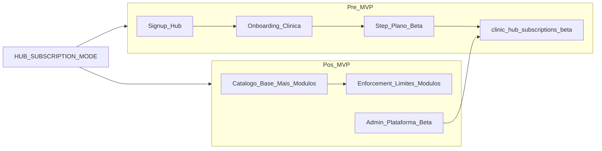

# Planos de assinatura do Hub — Beta (MVP) e catálogo pós-MVP

**Estado:** Fase 1 (pré-MVP) implementada no código — executar migration `082` no Supabase.

Plano de implementação da assinatura SaaS do PetMi Hub (o que a clínica/petshop paga para usar o produto). Distinto de **pacotes de serviço** (`hub_packages`), que são vendidos pelo negócio ao tutor.

Referências: [PERMISSIONS_ROADMAP.md](./PERMISSIONS_ROADMAP.md) (entitlements `module.*`), [PRODUCT_BOUNDARIES.md](./PRODUCT_BOUNDARIES.md) (billing base em `platform`), [HUB_SIGNUP_FIRST_ADMIN_AND_UNIT.md](./HUB_SIGNUP_FIRST_ADMIN_AND_UNIT.md) (onboarding).

Plano executável com todos: [`.cursor/plans/planos_hub_beta.plan.md`](../../.cursor/plans/planos_hub_beta.plan.md)

---

## Contexto e decisões de produto

- **Organização** = tabela `clinics` (já existente).
- **Pacotes Hub** (`hub_packages`, `hub_subscriptions`) são billing **cliente final** — não misturar com SaaS.
- Tabelas legadas `plans` / `clinic_subscriptions` são do Vet, sem uso no backend — **não reutilizar**; criar schema Hub dedicado em `petimi_hub/`.
- Modelo comercial:
  - **Plano base** = capacidade (unidades, usuários)
  - **Adicionais** = módulos operacionais (`clinic`, `grooming`, `boarding`)
  - **Beta** = override de cobrança + acesso total, gerenciado **somente pelo admin da plataforma** (`/admin`)

---

## Fase 1 — Pré-MVP

Antes do lançamento comercial: cadastro mostra **apenas o plano Beta** (acesso total, grátis, sem cartão).

### Schema

Migration `082_create_hub_platform_subscriptions.sql`:

| Tabela | Propósito |
|--------|-----------|
| `hub_platform_plans` | Catálogo base (`beta`, `vet_solo`, `solo`, `growth`, `network`) + `plan_config` |
| `hub_platform_modules` | Adicionais (`hub_core`, `clinic`, `grooming`, `boarding`) |
| `clinic_hub_subscriptions` | Assinatura ativa por clínica |

Campos beta em `clinic_hub_subscriptions`: `is_beta`, `beta_free_until`, `beta_discount_percent`, `override_monthly_cents`, `beta_notes`, `enabled_modules`.

Migration adicional: `140_alter_hub_platform_plans_vet_solo_config.sql` (Vet Solo R$ 69, Rede 10/50, `plan_config`).

### Backend

- `hubSubscriptionService.ts` — criar/ler assinatura, `organizationHasModule`, entitlements/session enriquecida
- `hubEntitlements.ts` / `requireHubEntitlement` — módulos, áreas do plano, limites, soft-lock
- Hook em `postHubOnboardingClinic` → `createBetaSubscription(clinicId)`
- `getHubSessionContext` retorna `subscription` no payload (módulos, áreas, usage, `access_mode`)
- `HUB_SUBSCRIPTION_MODE=beta_only` (default) | `catalog` (lançamento comercial)
- `GET /api/hub/subscription/plans`
- Runbook Fundador: [HUB_FOUNDER_BILLING_RUNBOOK.md](./HUB_FOUNDER_BILLING_RUNBOOK.md)

### Frontend Hub

Wizard de onboarding: Organização → Unidade → **Plano Beta** (card único, aceite de termos).

### Admin plataforma

`PATCH /api/admin/clinics/:clinicId/subscription` — editar beta, data limite, módulos, notas.

### Enforcement

Implementado: limites de unidade/usuário (exceto `is_beta`), módulos SaaS e áreas desabilitadas do plano (`vet_solo`), soft-lock por status. Backend é autoridade; frontend espelha (sidebar + `HubEntitlementGuard`).

Regra: `hasPermission(user, perm) AND organizationHasModule/planArea(org) AND capacity OK`.

### Matriz comercial (lançamento)

| Slug | Nome | Preço | Units | Users | Módulos |
|------|------|-------|-------|-------|---------|
| `vet_solo` | Vet Solo | R$ 69 | 1 | 2 | hub_core + clinic |
| `solo` | Essencial | R$ 149 | 1 | 5 | todos |
| `growth` | Expansão | R$ 297 | 3 | 20 | todos |
| `network` | Rede | R$ 497 | 10 | 50 | todos |
| `beta` | Fundador | R$ 0 | sem teto | sem teto | todos |

Pickup / recepção: não são SKUs; desligados no Vet Solo via `plan_config.disabled_operational_areas`. Estoque permanece no core.

### Migração Beta → pago

Ver [HUB_FOUNDER_BILLING_RUNBOOK.md](./HUB_FOUNDER_BILLING_RUNBOOK.md). Sem cobrança automática. Checkout Mercado Pago + `override_monthly_cents`.

### UI

- Pública: `/planos` — cards + tabela comparativa
- Autenticada: `/hub/assinatura`
- Admin: Gerenciar Fundador (`beta_free_until` + override)

Ativar catálogo comercial com `HUB_SUBSCRIPTION_MODE=catalog` após validar enforce.

---

## Mapeamento módulo → produto

| Módulo / área | Entitlement | Sidebar |
|---------------|-------------|---------|
| `hub_core` | `module.hub_core` | Agenda, Clientes, Caixa, Estoque |
| `clinic` | `module.clinic` | Clínica |
| `grooming` | `module.grooming` | Banho & Tosa |
| `boarding` | `module.boarding` | Hotel & Creche |
| área `leva_traz` | plan_config | Leva e Traz |
| área `recepcao` | plan_config | Recepção |

---

## Ordem de implementação

1. Migration + seeds
2. `hubSubscriptionService` + hook no onboarding
3. Session context + backfill
4. UI step Beta no onboarding
5. Admin plataforma para beta
6. (Pós-MVP) Catálogo, enforcement, sidebar gating
